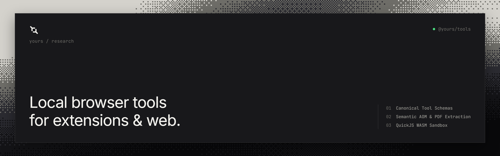
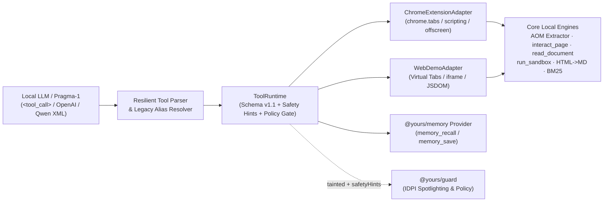

<p align="center">
  <a href="https://yours.sh">
    <picture>
      <source media="(prefers-color-scheme: dark)" srcset="https://raw.githubusercontent.com/yours-research/yours-tools/main/assets/hero-dark.png" />
      <source media="(prefers-color-scheme: light)" srcset="https://raw.githubusercontent.com/yours-research/yours-tools/main/assets/hero-light.png" />
      
    </picture>
  </a>
</p>

<p align="center">
  <a href="https://yours.sh">yours.sh</a> ·
  <a href="https://github.com/yours-research">GitHub Org</a> ·
  <a href="https://huggingface.co/yours-research">Hugging Face</a> ·
  <a href="https://x.com/yoursdotsh">X (@yoursdotsh)</a>
</p>

# `@yours/tools`

**Unified browser and web-demo assistant tools SDK (`Schema v1.1`) for Chromium MV3 extensions and [`yours.sh`](https://yours.sh) local AI web demos.**

`@yours/tools` gives small local models (`2B–9B`, including `Pragma-1`) a single deterministic tool layer that runs with **100% local parity** across both **Chromium Manifest V3 (`ChromeExtensionAdapter`)** and **embedded browser workspaces (`WebDemoAdapter`)** — with **zero external network requests by default**.

---

## Overview

- **Canonical Tool Schema v1.1 + Legacy Alias Resolution:** Unified definitions for all 10 tools (`read_active_tab`, `list_tabs`, `read_tab`, `interact_page`, `run_sandbox`, `read_document`, `search_web_tab`, `fetch_background_tab`, `memory_recall`, `memory_save`) with WebMCP-style `ToolSafetyHints`, OpenAI/Qwen/Pragma JSON-Schema exporters, and automatic resolution of legacy aliases (`read_active_page`, `list_open_tabs`, `web_search`, `fetch_and_read_url`, `js_calc`).
- **Semantic Accessibility Tree (AOM) Snapshotter:** Compresses cluttered web pages into compact, token-efficient node-ID maps (`[1] textbox:email "Email Address" (required)`), landmarks, forms, tables, and visible excerpts — piercing open Shadow DOM and cutting token usage by 80%+ vs. raw HTML.
- **Bounded DOM Actions (`interact_page`):** Executes `click`, `type`, `select`, `check`, `scroll`, `focus`, and `hover` against assigned semantic node IDs with post-action settled mutation diffing and safety gating on password inputs, form submissions, and `javascript:` links.
- **Offline Document Parser (`read_document`):** Extracts structured text, page ranges, and metadata from PDF, Markdown, HTML, CSV, JSON, and TXT inside an Offscreen Document or Web Worker (with pluggable `PdfBinaryExtractor` support for `pdfjs-dist`).
- **Air-Gapped Compute Sandbox (`run_sandbox`):** CSP-safe deterministic evaluator for math expressions, unit conversions, date arithmetic, JSON path queries, CSV stats, pipeline transforms, and QuickJS-WASM / AST-isolated JS snippets with strict timeout and memory ceilings and zero `eval`, `Function`, `fetch`, `chrome`, or global access.
- **Resilient Tool-Call Parser & BM25 Distiller:** Parses `<tool_call>` JSON, Qwen `<function=...>` XML, bare XML, fenced JSON, and OpenAI `tool_calls` while repairing trailing commas, unescaped newlines, and truncated braces.

---

## Architecture



---

## Quickstart

```bash
npm install @yours/tools
```

### 1. Parse Model Output & Export Schemas

```ts
import {
  parseToolCalls,
  toPragmaToolBundle,
  formatToolsForSystemPrompt,
} from '@yours/tools';

// Export Schema v1.1 for Pragma / OpenAI / Qwen system prompts
const pragmaBundle = toPragmaToolBundle();
const systemPromptTools = formatToolsForSystemPrompt(undefined, 'qwen-xml');

// Resiliently parse model output (automatically resolves legacy aliases too!)
const { cleanText, toolCalls, parseErrors } = parseToolCalls(
  'Checking page...\n<tool_call>{"name": "read_active_page", "arguments": {"mode": "aom",}}</tool_call>',
);
// toolCalls[0] -> { name: 'read_active_tab', originalName: 'read_active_page', arguments: { mode: 'aom', ... } }
```

### 2. Chromium MV3 Adapter

```ts
import { ChromeExtensionAdapter, createToolRuntime } from '@yours/tools/adapters';

const adapter = new ChromeExtensionAdapter({
  offscreenDocumentUrl: 'offscreen.html',
});
const runtime = createToolRuntime(adapter);

const aom = await runtime.execute({
  name: 'read_active_tab',
  arguments: { mode: 'aom', max_chars: 12000 },
});
```

### 3. Web Demo Adapter (`yours.sh`)

```ts
import {
  WebDemoAdapter,
  InMemoryMemoryProvider,
  createToolRuntime,
} from '@yours/tools/adapters';

const adapter = new WebDemoAdapter({
  initialTabs: [
    {
      url: 'https://yours.sh/playground',
      active: true,
      document: iframe.contentDocument ?? document,
    },
  ],
  allowNetwork: false, // Zero external network requests by default
});

const runtime = createToolRuntime(adapter, {
  memoryProvider: new InMemoryMemoryProvider(),
});

const res = await runtime.execute({
  name: 'interact_page',
  arguments: { action: 'click', node_id: 2 },
});
```

---

## Canonical Tool Catalog (v1.1)

| Canonical Name | Legacy Aliases | Read-Only | Consequential | Network | Untrusted Content | Purpose |
| :--- | :--- | :---: | :---: | :---: | :---: | :--- |
| `read_active_tab` | `read_active_page` | Yes | No | No | Yes | Extract AOM snapshot, markdown, selection, PDF, or YouTube captions from active tab |
| `list_tabs` | `list_open_tabs` | Yes | No | No | Yes | List open tabs (`id`, `title`, `url`, `active`, `windowId`) |
| `read_tab` | — | Yes | No | No | Yes | Read or BM25-query a specific tab by `tab_id` |
| `interact_page` | — | **No** | **Yes** | No | Yes | Bounded `click`/`type`/`select`/`check`/`scroll` by `node_id` with settled DOM diff |
| `run_sandbox` | `js_calc` | Yes | No | No | No | Air-gapped math, units, dates, JSON path, CSV stats, transforms, and QuickJS-WASM |
| `read_document` | — | Yes | No | No | Yes | Offline PDF, Markdown, HTML, CSV, JSON, TXT extraction for Offscreen/Worker |
| `search_web_tab` | `web_search` | Yes | No | **Yes** | Yes | Policy-gated hidden-tab SERP search + optional source distillation |
| `fetch_background_tab` | `fetch_and_read_url` | Yes | No | **Yes** | Yes | Policy-gated background URL fetch + HTML-to-Markdown + BM25 excerpts |
| `memory_recall` | — | Yes | No | No | No | Search local persistent memory tiers (`working`, `profile`, `episodic`, `document`) |
| `memory_save` | — | **No** | **Yes** | No | No | Persist structured facts or preferences to `@yours/memory` |

---

## Yours Research Ecosystem

| Package | Role | License |
| :--- | :--- | :--- |
| **[`yours-tools`](https://github.com/yours-research/yours-tools)** | Unified browser & web-demo tools SDK (AOM, DOM actions, sandbox, offline docs) | Apache-2.0 |
| [`yours-harness`](https://github.com/yours-research/yours-harness) | Pluggable local inference runtime adapter (WGSL WebGPU, Transformers.js, Chrome AI, HTTP) | Apache-2.0 |
| [`yours-memory`](https://github.com/yours-research/yours-memory) | Local encrypted multi-tier browser memory (BM25 + vector + recency) | Apache-2.0 |
| [`yours-models`](https://github.com/yours-research/yours-models) | Verified model delivery, Merkle manifests & WebGPU hardware prober | Apache-2.0 |
| [`yours-guard`](https://github.com/yours-research/yours-guard) | Browser security, IDPI spotlighting & lethal-trifecta policy engine | Apache-2.0 |
| [`yours-voice`](https://github.com/yours-research/yours-voice) | Local streaming ASR/TTS voice pipeline with barge-in support | Apache-2.0 |
| [`yours-evals`](https://github.com/yours-research/yours-evals) | Cross-stack automated eval harness and scorecards | Apache-2.0 |
| [`yours-browser-extension`](https://github.com/yours-research/yours-browser-extension) | Flagship Chromium MV3 local AI assistant built on the `@yours/*` stack | Apache-2.0 |

---

<p align="center">
  <strong>yours / research</strong> · Making local inference for everyone.
</p>
